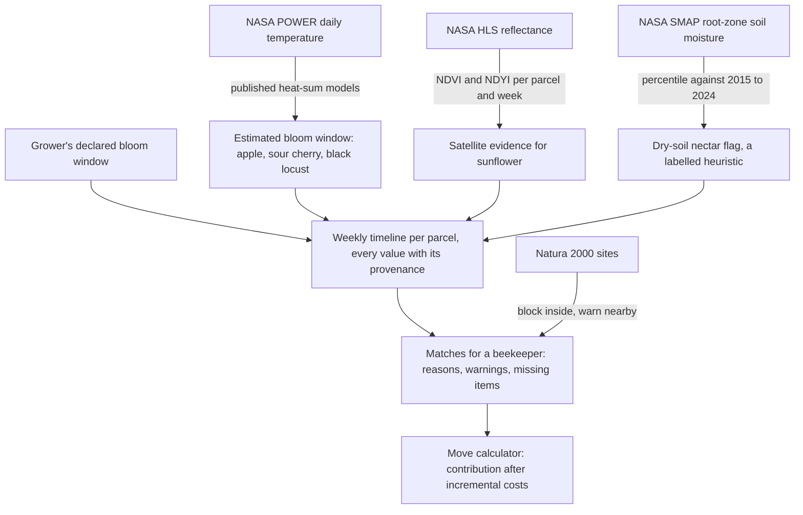

<div align="center">

# Pollination Marketplace

**by Terra & Luna Analytics · NASA Space Apps Challenge 2026**

NASA Earth observations tell beekeepers and growers when and where crops bloom, and whether moving hives there pays off

[](https://www.spaceappschallenge.org/2026/) [](https://www.spaceappschallenge.org/2026/find-a-team/terra-and-luna-analytics/?tab=project)

[](LICENSE)
[](https://www.python.org/)
[](#data-and-citations)
[](AI_USAGE.md)

[About](#about) · [Run it](#run-it) · [Repo layout](#repository-layout) · [Data](#data-and-citations) · [Team](#team)

</div>

## About

Migratory beekeepers and growers of insect-pollinated crops (orchards, sunflower, black locust and more) need to meet
at the right place in the right week, anywhere in the world. Our map shows, week by week through the season:

- When each parcel blooms: from published heat-sum models on NASA POWER temperatures for apple, sour cherry and black
  locust, next to the grower's declared window; for sunflower the declared window, with the NASA HLS yellowness index
  (NDYI) shown as evidence
- Sunflower bloom on exceptionally dry soil, flagged from NASA SMAP root-zone soil moisture as a labelled heuristic
  (nectar at risk, for example in the 2022 drought)
- Protected sites (Natura 2000 in the demo): hives inside one are blocked, and sites nearby trigger a warning
- Explainable matches between a beekeeper and parcels, with reasons, missing items and confidence
- A move calculator with the contribution after incremental costs and the benefit compared with staying put, so a
  beekeeper also sees when not to move

Every number carries its provenance: Observed, Estimated, Reported or Missing, plus a date. NASA data is global and
fetched live; the demo runs on one pilot region with synthetic actors and illustrative parcels.

The build follows the [48-hour MVP plan (v3)](docs/implementation_plans/nasa_space_apps_48_hour_hackathon_mvp_planv3.md).

## Run it

### With Docker (any machine)

```bash
git clone https://github.com/gabboraron/NASA_SpaceAppsChallange2026-Terra_and_Luna_Analytics.git
cd NASA_SpaceAppsChallange2026-Terra_and_Luna_Analytics
docker compose up --build        # then open http://localhost:8080
```

One container serves the map client at http://localhost:8080 and the API under `/api`
(OpenAPI docs at http://localhost:8080/api/docs).

No login is needed for the demo: the repository ships a small warmed cache of the NASA responses for both demo
seasons (`data/nasa-cache.zip`, see [`docs/cache_setup.md`](docs/cache_setup.md)), which the API imports when it starts.
New responses are cached in the `nasa-cache` volume, so they survive rebuilds. Run `docker compose down -v` to clear it.

Optional settings go in a `.env` file next to `compose.yaml`. It is gitignored, so never commit it.

| Variable | Purpose |
|---|---|
| `EARTHDATA_USERNAME`, `EARTHDATA_PASSWORD` or `EARTHDATA_TOKEN` | [NASA Earthdata login](https://urs.earthdata.nasa.gov), needed only for HLS and SMAP reads the shipped cache does not hold (for example a field drawn on the map). POWER needs no login |
| `WEB_PORT` | Host port (default 8080) |
| `VITE_USE_MOCKS` | `true` builds the map client against built-in mock data instead of the API |

### Local development

Needs [uv](https://docs.astral.sh/uv/) and Node 22. Full setup, including git hooks: [`SETUP.md`](SETUP.md).

```bash
uv sync
uv run uvicorn pollination.api:app --reload      # API on :8000
cd frontend && npm ci && npm run dev             # map on :5173, /api proxied to :8000
```

Checks (same as CI): `uv run ruff check . && uv run ruff format --check . && uv run pyright && uv run pytest`.

## Repository layout

```text
.
├── src/pollination/     FastAPI app, models (API contract), engine/ (calculator, …), nasa/ (POWER, cache, …)
├── tests/               pytest
├── verification/        checks of the bloom models against past ground truth (own README)
├── frontend/            React + Vite + MapLibre map client
├── data/                parcels, Natura 2000, phenology, synthetic actors, ranking weights
├── scripts/             one-off data builders and the Earthdata access probe
├── docs/                implementation plan, engineering guide
├── compose.yaml         Docker stack (one image: API + built map client); Dockerfile
└── AI_USAGE.md          AI use disclosure required by Space Apps
```

## How it works



The [verification folder](verification/README.md) compares the bloom models with hive-scale records and dated
observations from past years, and lists what the models cannot yet show.

## Data and citations

| Source | Used for | Access / licence |
|---|---|---|
| [NASA HLS](https://lpdaac.usgs.gov/products/hlss30v002/) (HLSS30 / HLSL30 v2.0, LP DAAC) | NDVI, NDYI (sunflower bloom evidence) | Earthdata login; NASA open data |
| [NASA SMAP L4](https://nsidc.org/data/spl4smgp) (SPL4SMGP, NSIDC) | Root-zone soil moisture, drought percentile | Earthdata login; NASA open data |
| [NASA POWER](https://power.larc.nasa.gov/) daily point API (MERRA-2 based) | Temperature (GDD), precipitation, wind | No login; NASA open data |
| [EEA Natura 2000](https://bio.discomap.eea.europa.eu/arcgis/rest/services/ProtectedSites/Natura2000Sites/MapServer) (EEA map service) | Protected-area boundaries | EEA reuse policy |
| [OpenStreetMap](https://www.openstreetmap.org/copyright) via Overpass | Illustrative parcel geometry | ODbL |
| [OpenFreeMap](https://openfreemap.org/) | Basemap tiles | OSM data, ODbL |
| [Esri World Imagery](https://www.arcgis.com/home/item.html?id=10df2279f9684e4a9f6a7f08febac2a9) | Optional satellite basemap | Esri terms of use; attribution shown on the map |
| Published phenology models, cited per value in [`data/phenology.json`](data/phenology.json) | Bloom model parameters | Scientific literature |
| Hive-scale records, iNaturalist and PEP725, cited in [`verification/README.md`](verification/README.md) | Checking the models, not used by the app | CC BY 4.0 and the providers' terms |

Fonts (Inter, Space Grotesk) are loaded from Google Fonts under the SIL Open Font License.

Beekeepers and growers in `data/actors.json` are **synthetic**. Parcels are **illustrative**, not real holdings.

## Team

- Patrik P. Süli
- Bence Majer
- Benedek Máté
- Yhair Sifuentes
- Sándor Burian
- Zsolt Laczkó

## AI use

Space Apps allows AI assistants. We use Claude Code and GitHub Copilot for research and code; the team came up with
the solution idea. [`AI_USAGE.md`](AI_USAGE.md) lists the tools and how AI output is labelled.

## License

Code: [Mozilla Public License 2.0](LICENSE). Third-party data keeps its own licence (see [Data and citations](#data-and-citations)).

<div align="center"><sub>Built for NASA Space Apps 2026 · not affiliated with or endorsed by NASA</sub></div>
