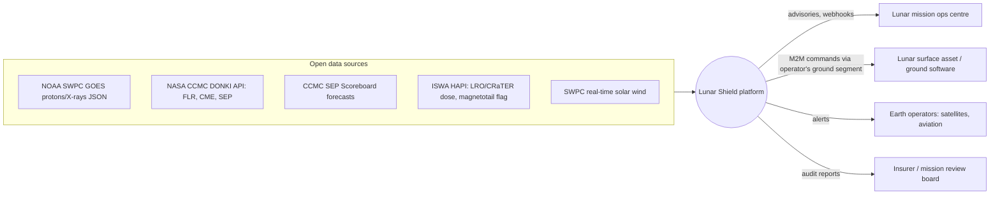
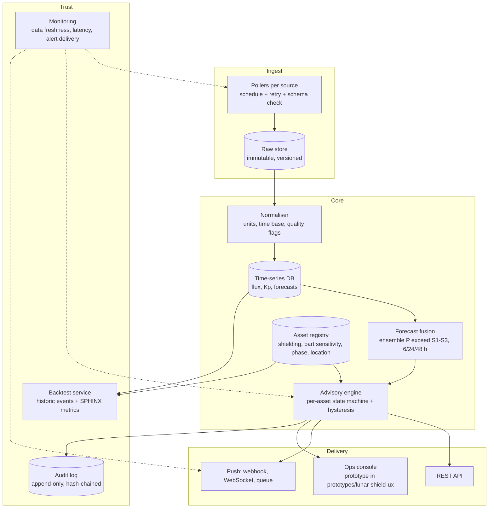
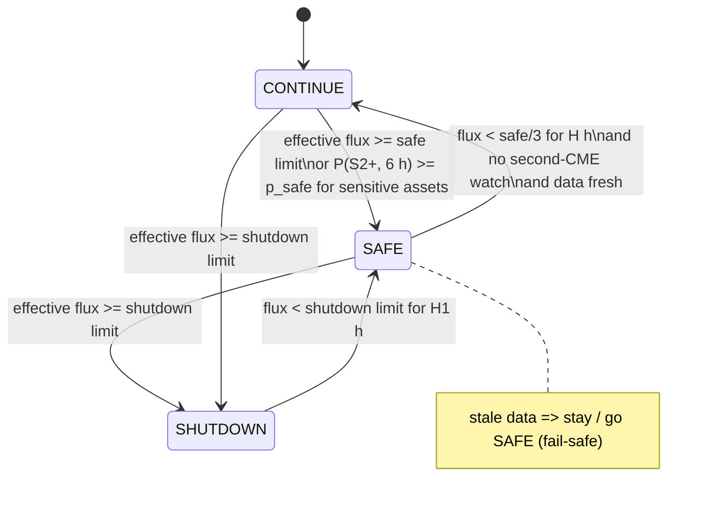

# Lunar Shield: solution architecture (from hackathon MVP to an operational product)

Draft, 14 Nov 2026, written with Claude Code as a solution-architect exercise. It describes how Lunar Shield could run
as a real service. The hackathon builds only the MVP slice (section 9). Labels follow `00-methodology.md`:
[official] or [paper] = cited source, [tested] = endpoint checked on 14 Nov 2026 (`02b-lunar-shield-data.md`),
[estimate] = design judgement, [unverified] = not checked. The UX prototype is in `prototypes/lunar-shield-ux/index.html`.
Business-model numbers wait for the second feasibility report (pending).

## 1. Problem and scope

- **Users:** operators of robotic lunar surface assets (prospecting, drilling, ISRU plants, rovers, landers, relays) and,
  as a second segment, Earth operators hit by the same events (satellites, polar aviation, crewed flight).
- **Job to be done:** "Tell my asset, in machine-readable form, when to go to safe mode, when to power down, and when it is
  safe to restart, and keep a record of why."
- **Not in scope:** building a new solar-energetic-particle (SEP) forecast model. Community models already exist and are
  validated by NASA SRAG and the CCMC SEP Scoreboard [paper] (https://ntrs.nasa.gov/citations/20260000463,
  https://ccmc.gsfc.nasa.gov/scoreboards/sep/). Lunar Shield fuses them and translates them into per-asset actions.
- **Why the restart side matters:** SRAG lists all-clear forecasts at 6/24/48 h as an operational need, and SWPC notes that
  the end of an event takes hours to confirm [paper] (`02-lunar-shield-science.md`, sections on gaps).

## 2. Key requirements

| ID | Requirement | Target | Why |
|---|---|---|---|
| F1 | Ingest live space-weather data (GOES protons, DONKI events, SEP Scoreboard forecasts) | every 1–5 min | Protons arrive in < 1 h after onset [paper] |
| F2 | Fused probability of exceeding S1/S2/S3 at 6/24/48 h, with uncertainty | per update | Single models show peak-flux errors up to two orders of magnitude [paper] |
| F3 | Per-asset advisory: CONTINUE / SAFE / SHUTDOWN + restart window | per update, per asset | Core product |
| F4 | Restart rule with hysteresis and a second-CME hold | configurable per asset | Main differentiator |
| F5 | Push alerts machine-to-machine (webhook, WebSocket, message queue) | — | Assets and ground systems act without a human in the loop |
| F6 | Audit trail: every advisory stores its inputs, model versions and source URLs | 100 % | Insurers, mission boards, explainability |
| F7 | Backtest any rule on historic events with SPHINX-style metrics | on demand | Validity for customers (`ktindiana/sphinxval`) |
| N1 | Ingest-to-alert latency | ≤ 60 s p95 [estimate] | Small next to a 30–90 min warning lead time [paper] |
| N2 | Availability of the alert path | 99.9 % [estimate] at product stage | A missed alert costs hardware |
| N3 | Degrade safely | Stale data → advisory flips to "data stale, apply conservative default" | Fail-safe, never silent |
| N4 | Multi-tenant isolation | Asset profiles and logs per customer | Operators treat part data as confidential |
| N5 | Explainable output | Each advisory carries `reason` and `sources[]` | Team rule; customer trust |

## 3. Context (C4 level 1)



Lunar Shield never commands a spacecraft directly. It sends advisories to the operator's ground segment, which decides
and uplinks. That keeps liability and command authority with the operator [estimate, design choice].

## 4. Containers (C4 level 2)



| Container | Responsibility | Notes |
|---|---|---|
| Pollers | Pull each source on its own schedule; validate schema; tag quality | Sources move: DONKI moved from api.nasa.gov to `ccmc.gsfc.nasa.gov/DONKI-API` and old SWPC solar-wind paths return 404 [tested]. Each poller has a contract test that alarms when a source changes |
| Raw store | Keep every fetched payload unchanged | Needed for audit and replay |
| Normaliser | One time base (UTC), units (pfu, MeV), quality flags; resolve primary GOES satellite from `instrument-sources.json` | [tested] SWPC publishes which GOES is primary |
| Forecast fusion | Combine Scoreboard models + simple nowcast (flux trend) into calibrated probabilities with spread | Start with a weighted ensemble; weights from SEPVAL skill scores [paper] |
| Advisory engine | Deterministic per-asset state machine (CONTINUE → SAFE → SHUTDOWN → restart after hysteresis, hold on second-CME watch) | Deterministic on purpose: the same inputs always give the same advisory, which is easy to audit and certify |
| Asset registry | Customer-entered profiles: shielding (g/cm²), part SEE sensitivity, duty phase, location, restart cost | Location matters only for terrain shielding (small at landing sites: open-sky fraction 0.92–0.98 [computed]) |
| Audit log | Append-only, hash-chained records of inputs → advisory | Lets a customer prove after an incident why the asset was or was not shut down |
| Backtest service | Replay rules on events from the NOAA proton-event list / GSEP | Tools exist: `ktindiana/fetchsep`, `ktindiana/sphinxval` [paper] |

## 5. Advisory engine (the core logic)



- **Effective flux** = measured or forecast flux × asset shielding factor. The real product replaces this factor with a
  response model per part class (dose and single-event-effect rate vs. spectrum) [estimate].
- **Hysteresis** stops flapping: in the prototype the drill rig has 6 state changes without hysteresis and 2 with it
  [computed, synthetic event, `prototypes/lunar-shield-ux`]. The cost is more offline hours; the customer sets that trade-off.
- **Second-CME hold:** a new Earth/Moon-directed CME in DONKI blocks restarts until its window passes. Anomaly rates peak
  4–5 days after onset [paper] (`02-lunar-shield-science.md`).

## 6. Data model (simplified)

```json
// Asset profile (POST /v1/assets)
{ "asset_id": "drill-01", "tenant": "op-123", "class": "mining_drill",
  "location": {"lat": -84.79, "lon": 29.20}, "shielding_gcm2": 2.0,
  "see_sensitivity": "high", "phase": "drilling",
  "limits": {"safe_pfu": 30, "shutdown_pfu": 300}, "restart": {"hysteresis_h": 6, "hold_on_cme": true} }

// Advisory (GET /v1/assets/{id}/advisory, also pushed)
{ "asset_id": "drill-01", "issued": "2026-11-14T10:05:00Z", "action": "SAFE",
  "reason": "P(S2+ within 6 h) = 0.62 after X-class flare; asset sensitivity high",
  "restart_window": {"earliest": null, "blocked_by": ["flux_above_threshold"]},
  "environment": {"proton_10MeV_pfu": 0.4, "noaa_s_scale": 0, "p_s2_6h": 0.62},
  "data_freshness_s": 45, "engine_version": "1.4.2", "fusion_version": "2026.11",
  "sources": [ {"url": "https://services.swpc.noaa.gov/json/goes/primary/integral-protons-7-day.json", "fetched": "..."},
               {"url": "https://ccmc.gsfc.nasa.gov/DONKI-API/get/FLR", "fetched": "..."} ],
  "audit_hash": "sha256:..." }
```

Standards to align with later: CCSDS message formats used by ground segments and the LunaNet interoperability work,
which mentions space-weather alerting services [unverified: confirm the exact LunaNet document and version before citing].

## 7. Deployment on Azure (sponsor credit) and the product stage

| Concern | Hackathon (USD 200 / 30 days) | Product stage |
|---|---|---|
| Pollers | Azure Functions, timer trigger, consumption plan | Same, in two regions, plus a second independent poller path |
| Raw store | Blob Storage | Blob with immutability policy (WORM) |
| Time series | SQLite/Parquet in Blob, or Postgres Flexible B1 | Azure Data Explorer or TimescaleDB |
| Fusion + rules | FastAPI on Container Apps (scale to zero) | Container Apps / AKS, active-active in two regions |
| Push | WebSocket from FastAPI; webhooks | Event Grid / Service Bus with retries and delivery receipts |
| Audit | Append-only table | Hash-chained log + periodic anchor (e.g. signed daily digest) |
| UI | Static page on GoDaddy domain or Static Web Apps | Same, behind Entra ID / customer SSO |
| Monitoring | Application Insights, budget alerts at USD 50/100/150 | + synthetic "fake event" tests every hour, on-call |
| Secrets | `.env` locally, Key Vault in Azure | Key Vault, managed identities |

Cost at hackathon scale: tens of USD for the month [estimate], well inside the credit. No GPUs are needed: fusion is
arithmetic over a few model outputs.

## 8. Reliability, security and risk

| Risk | Impact | Mitigation |
|---|---|---|
| Upstream source changes or goes down (already happened to DONKI and SWPC paths) [tested] | Silent wrong advisories | Contract tests, freshness SLO, fail-safe default, at least two sources per quantity (GOES + Scoreboard) |
| False alarm | Lost operating hours, costly restarts (thermal plants) | Per-asset cost model, customer-tuned thresholds, backtest report before go-live |
| Missed event | Hardware damage | Conservative defaults, nowcast path that does not depend on forecasts |
| Liability | Legal exposure | Advisory only; operator keeps command authority; audit trail |
| Tenant data leak (part sensitivities) | Trust | Per-tenant encryption, row-level security, no cross-tenant analytics |
| Model drift / new models | Calibration loss | Versioned fusion weights, monthly re-scoring against SEPVAL-style benchmarks |
| Export control on detailed part data | Compliance | Store only the sensitivity class the customer chooses to share [estimate] |

## 9. Hackathon MVP slice (what we would actually build by Sun 16:00)

- One poller each for GOES protons and DONKI (FLR, CME, SEP), cached to disk.
- Fusion = nowcast trend + a simple rule on DONKI flare/CME events (no Scoreboard integration unless time allows).
- Advisory engine exactly as in section 5, with 4–5 example assets.
- Replay mode on 2–3 real historic events (the event list comes from the pending research report) instead of the
  synthetic curve in the UX prototype.
- One backtest number per event: hours of warning, hours offline, restart cycles, with vs. without hysteresis.
- FastAPI + the ops console (`prototypes/lunar-shield-ux`) on Container Apps or a static host.

Challenge fit: research flagged that challenge 11 does not mention radiation; the team judged the fit acceptable on
14 Nov (`DECISIONS.md`). Asset limits are set by each operator: the product delivers the signal and the restart window,
and each company decides how each robot reacts.

## 10. Roadmap after the hackathon [estimate]

| Phase | Content |
|---|---|
| 0. Hackathon | MVP slice, replay of real events, public demo |
| 1. Pilot (3–6 months) | Scoreboard fusion, per-part response models, backtest on the full NOAA event list, one pilot operator |
| 2. Product | Multi-region, SLA, SSO, Earth-operator alerts, insurer audit reports |
| 3. Extensions | Directional SEP + terrain shielding, Mars assets, onboard "edge" version of the rule engine for autonomy during comm gaps |
