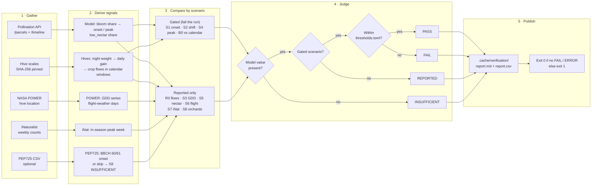

# Verification methodology

How we check that the pollination model's bloom and nectar signals match past
ground truth. How to run the suite is in [`README.md`](README.md); gates live in
[`thresholds.toml`](thresholds.toml).

## Principle

The product predicts **when** a crop blooms and **whether** nectar is likely.
We do not use pollen forecast APIs: they cover wind-pollinated allergen taxa,
cannot rewind past seasons, and are themselves model outputs. Instead we compare
the running API's timeline for past demo years with independent measurements:

| Side | Source | Role |
|---|---|---|
| Model | `/parcels` + `/timeline?year=` (POWER GDD, HLS NDYI, SMAP rule) | Onset, peak, `low_nectar`, flight weather |
| Reference | Hive-scale daily weight gains (Mendeley) | Nectar-flow onset, peak, season kg |
| Reference | iNaturalist research-grade weekly counts | Locust peak timing (portable check) |
| Reference | NASA POWER at the hive location | GDD clock and flight-day rule |
| Optional | PEP725 BBCH 60/61 (user-supplied) | Orchard onset |

Gates (S1, S2, S4, B0) were fixed **before** the first run on real model output.
A missing model value yields **INSUFFICIENT**, never a pass.

## Workflow

Validation is a left-to-right pipeline: gather inputs, derive comparable
signals on both sides, run one scenario per question, then judge and write the
report. Years under test default to 2022 and 2024. Timeline weeks start on
1 March; hive and iNaturalist dates stay on the calendar, so every comparison
is by date.

### Signal rules (step 2)

| Stream | Rule |
|---|---|
| Model bloom week | ≥ 50% of the crop's parcels are blooming |
| Model onset | Modelled bloom start of parcels blooming in the first bloom week |
| Model peak | Week of maximum bloom share |
| Hive daily gain | Next night's rest weight − this night's (before 05:00); jumps over 5 kg dropped |
| Hive flow | ≥ 0.3 kg/day foraging days, ≤ 2 gap days, ≥ 3 kg total; largest peak inside the crop window |
| Crop windows | Locust 10 Apr–20 Jun; sunflower 15 Jun–31 Aug |

### Scenario map (step 3)

| ID | Model signal | Reference | Outcome |
|---|---|---|---|
| R0 | — | Hive flows | REPORTED |
| S1 | Locust onset (POWER GDD) | Hive spring-flow onset | Gated ≤ 10 days |
| S2 | Locust onset shift 2022→2024 | Hive shift (iNat shown) | Gated ≤ 7 days, same direction |
| S3 | GDD at hive onsets | Leave-one-year-out | REPORTED |
| S4 | Sunflower peak | Hive summer-flow peak | Gated ≤ 14 days |
| S5 | `low_nectar` share (SMAP) | Season flow kg | REPORTED |
| S6 | Flight-weather days | Daily hive gain | REPORTED |
| S7 | Locust peak | iNaturalist peak | REPORTED |
| S8 | Orchard onset | PEP725 BBCH 60/61 | REPORTED / INSUFFICIENT |
| B0 | S1 + S4 errors | Mean date of other years | Gated: model ≤ calendar MAE |

## What a pass means

Only S1, S2, S4 and B0 can fail the run. Reported scenarios (R0, S3, S5–S8)
inform calibration and never set exit code 1 on their own. Crash → ERROR;
missing model or reference evidence → INSUFFICIENT (never a silent pass).

## Limits

Hive data is two colonies at one apiary; flows are attributed by calendar
window (spring rape can overlap locust); sunflower bloom in the demo timeline
is the grower's declared window; S5 used these hives when tuning the nectar
rule. Details and licences: [`README.md`](README.md).
